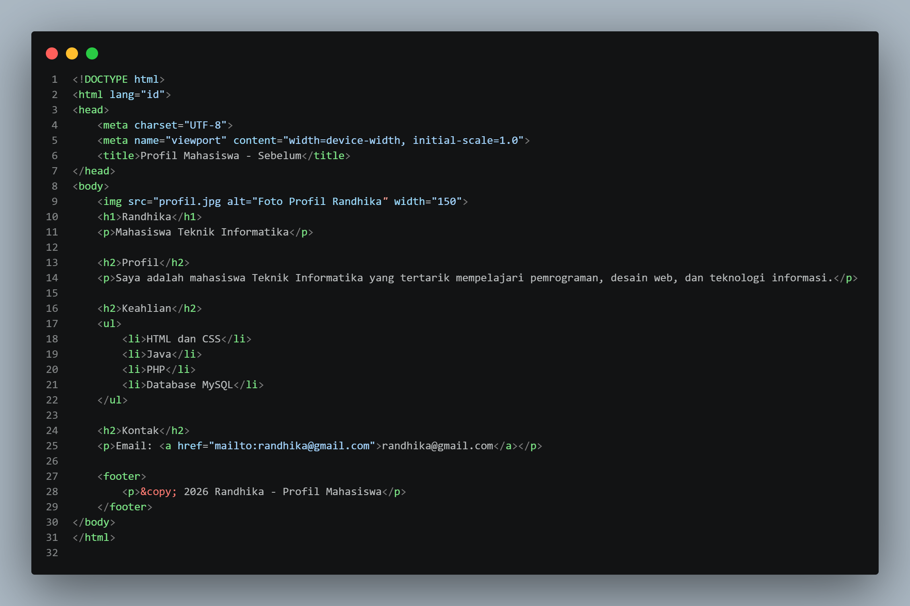
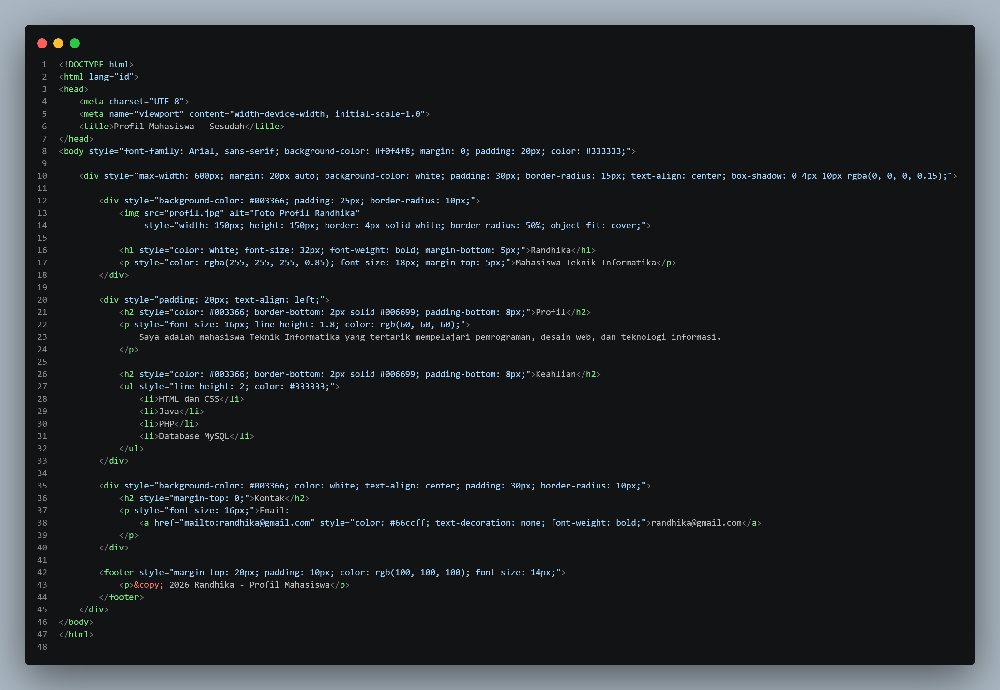
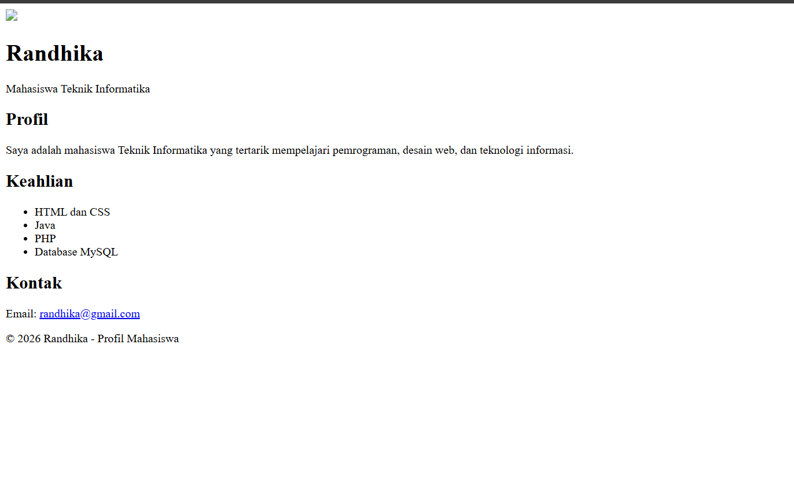
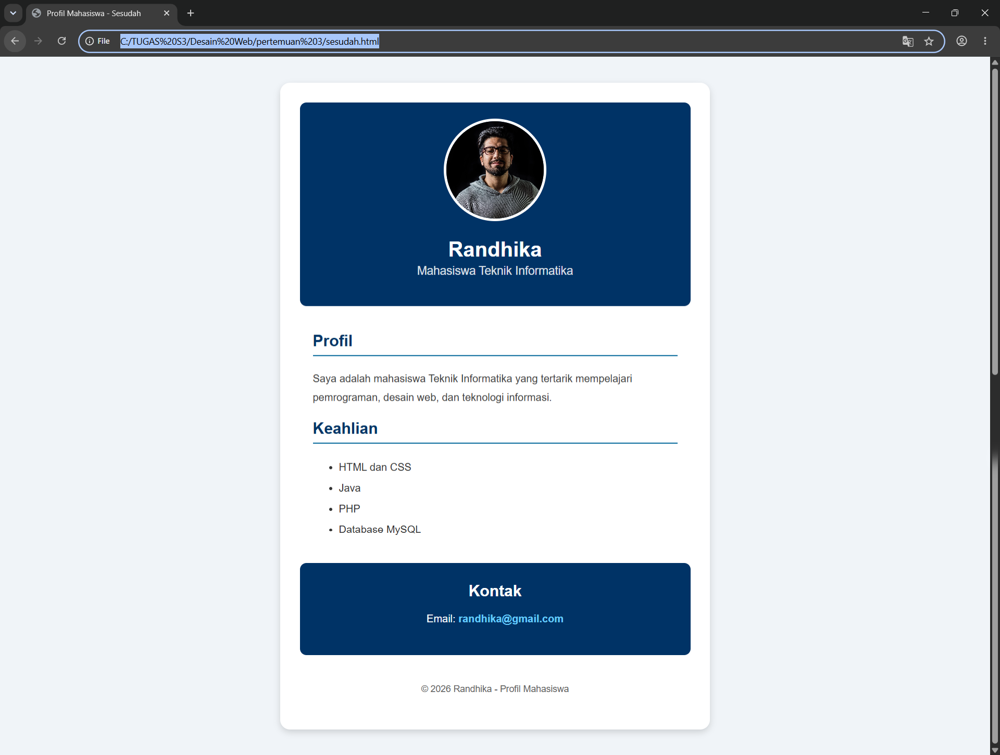

### TUGAS PRAKTIKUM PERTEMUAN 3 - PENGENALAN CSS
## Identitas Mahasiswa
- Nama: Aqsa Ibnu Rizik
- NPM: 4525210103
- Program Studi: Teknik Informatika
- Universitas: Universitas Pancasila
- Semester: 3

### PERUBAHAN
- Menambahkan warna latar, warna teks, ukuran dan ketebalan font.
- Menambahkan padding, margin, border, border-radius, dan box-shadow.
- Mengatur foto menjadi 150x150 piksel dengan bingkai putih dan bentuk lingkaran.
- Membuat bagian kontak berlatar navy dan teks rata tengah.
- Menggunakan format warna nama warna, HEX, RGB, dan RGBA.

### MASALAH DAN SOLUSI
Masalah: halaman awal terlihat sederhana dan belum memiliki pengaturan tampilan yang konsisten.
Solusi: menambahkan CSS Inline langsung pada atribut style elemen HTML sehingga tidak memerlukan file CSS terpisah.

### DOKUMENTASI SEBELUM DAN SESUDAH
## codingan sebelum :

## codingan sesudah :

### HASil :
## Hasil sebelum :

## Hasil sesudah
