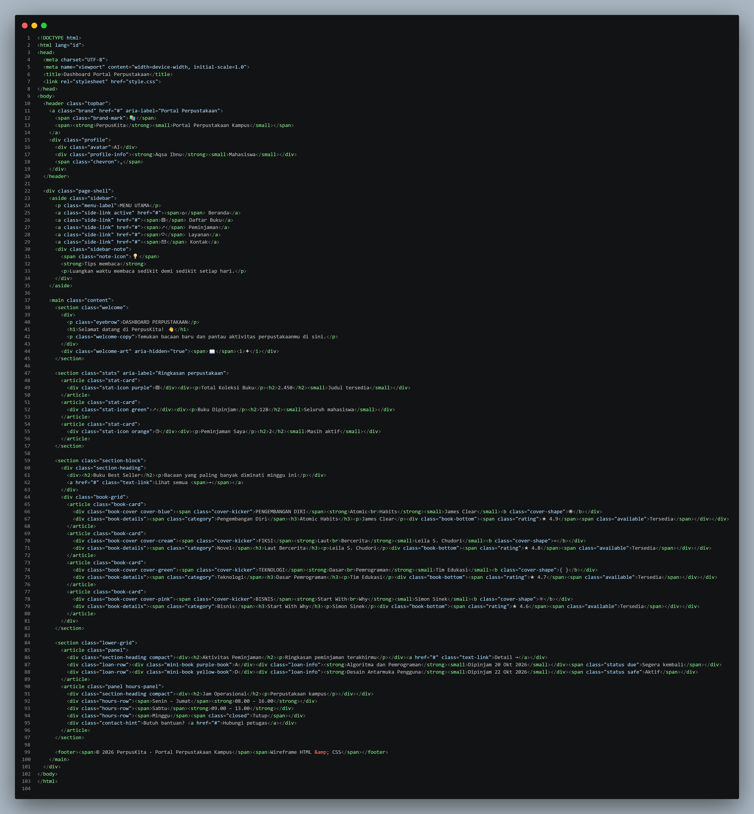
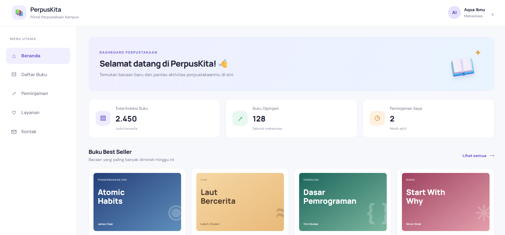

# LAPORAN STUDI KASUS
## Dashboard Portal Perpustakaan Umum

## Identitas Mahasiswa
- Nama: Aqsa Ibnu Rizik
- NPM: 4525210103
- Program Studi: Teknik Informatika
- Universitas: Universitas Pancasila
- Semester: 3

### 1. Pendahuluan
Studi kasus ini membuat wireframe website Dashboard Portal Perpustakaan Umum menggunakan HTML dan CSS. Website dirancang untuk membantu mahasiswa melihat ringkasan informasi perpustakaan, menemukan buku, dan memantau aktivitas peminjaman dengan mudah.

### 2. Struktur Halaman
Website menggunakan struktur berikut:

- **Header**: menampilkan logo placeholder perpustakaan serta nama dan profil pengguna.
- **Sidebar**: menyediakan menu Beranda, Daftar Buku, Peminjaman, Layanan, dan Kontak. Pada tugas ini digunakan sidebar sebagai navigasi.
- **Konten utama**: menampilkan sambutan pengguna dan ringkasan informasi perpustakaan.
- **Kartu ringkasan**: menampilkan jumlah koleksi buku, buku yang sedang dipinjam, dan jumlah peminjaman pengguna.
- **Buku Best Seller**: menampilkan beberapa contoh buku beserta kategori, penulis, rating, dan status ketersediaan.
- **Aktivitas Peminjaman**: menampilkan contoh buku yang sedang dipinjam dan statusnya.
- **Jam Operasional**: memberikan informasi contoh jadwal layanan perpustakaan.
- **Footer**: menampilkan informasi portal dan hak cipta.

### 3. Teknologi yang Digunakan
- **HTML5** untuk menyusun struktur dan konten halaman.
- **CSS3** untuk mengatur warna, jarak, tipografi, kartu, grid, dan tata letak.
- **CSS Flexbox dan Grid** untuk menyusun komponen halaman.
- **Media queries** untuk menyesuaikan tampilan pada ukuran layar yang berbeda.

### Hasil dan codingan
## codingan :

## hasil :

### 4. Kesimpulan
Dashboard Portal Perpustakaan Umum ini merupakan contoh wireframe berbasis HTML dan CSS yang menyajikan navigasi, ringkasan koleksi, buku populer, aktivitas peminjaman, dan jam operasional dalam satu halaman. Struktur yang terorganisasi dan desain responsif membantu informasi ditampilkan dengan lebih jelas pada desktop maupun perangkat mobile.
