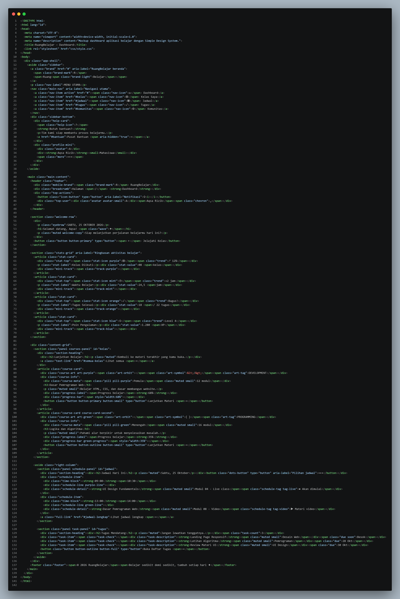
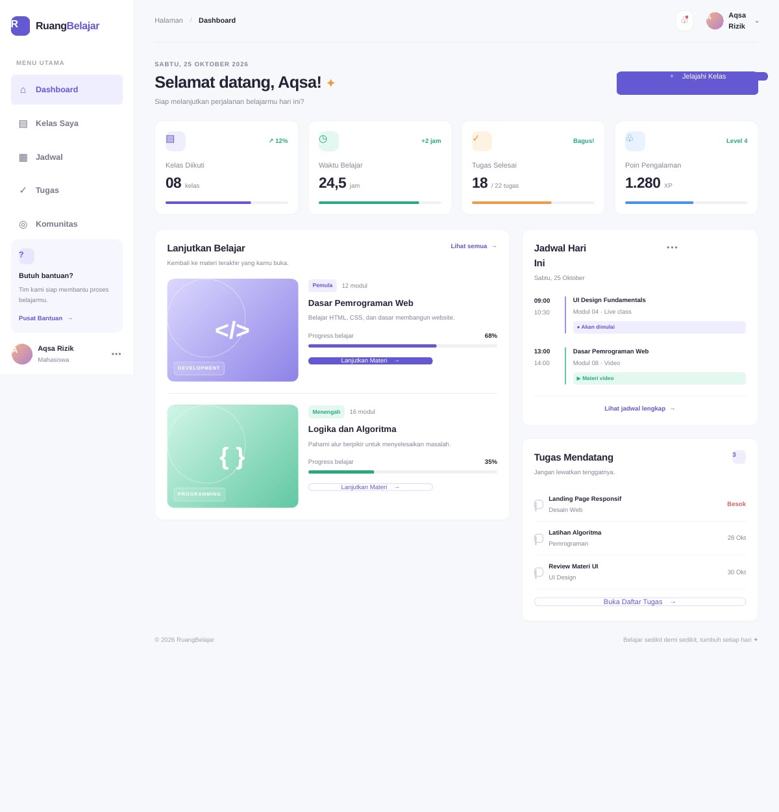
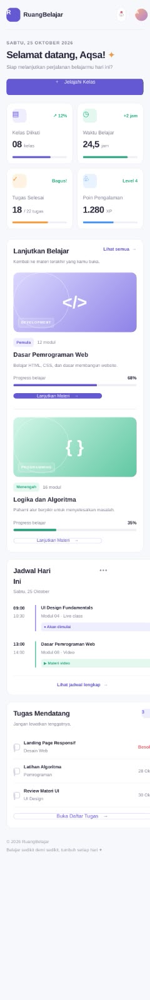

# Simple Design System — RuangBelajar

**Nama:** Aqsa Ibnu Rizik  
**NPM:** 4525210103  
**Mata kuliah:** Desain Web  
**Jenis tugas:** Tugas Praktikum Individu

## 1. Deskripsi Proyek

Proyek ini membuat **Simple Design System** dan menerapkannya pada mockup dashboard platform belajar bernama **RuangBelajar**. Dashboard berisi ringkasan aktivitas belajar, kelas yang sedang diikuti, jadwal, dan tugas mendatang. Desain dibuat menggunakan HTML5 dan CSS3 murni tanpa framework.

## 2. Penerapan pada Mockup

Bagian yang dibuat pada halaman:

1. **Sidebar dan header:** navigasi, identitas aplikasi, dan profil pengguna.
2. **Welcome section:** sapaan pengguna dan tombol untuk menjelajahi kelas.
3. **Statistik:** kelas diikuti, waktu belajar, tugas selesai, dan poin pengalaman.
4. **Lanjutkan Belajar:** dua kartu kelas beserta progres.
5. **Jadwal Hari Ini:** daftar sesi belajar dan jenis kegiatan.
6. **Tugas Mendatang:** daftar tugas dan tenggat waktu.
7. **Footer:** informasi hak cipta dan pesan singkat.

## 3. Tampilan Desktop dan Mobile

codingan :

Dekstop :

Mobail :

## 4. Kesimpulan

Simple Design System RuangBelajar menyatukan aturan warna, typography, spacing, tombol, kontrol form, dan kartu agar tampilan lebih konsisten serta mudah dikembangkan. Penerapan pada dashboard menunjukkan penggunaan komponen berulang dan layout responsif untuk desktop serta mobile.
