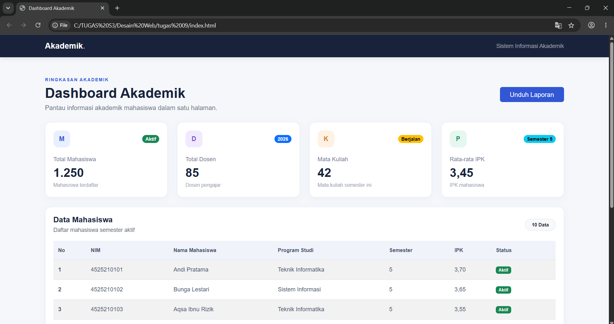
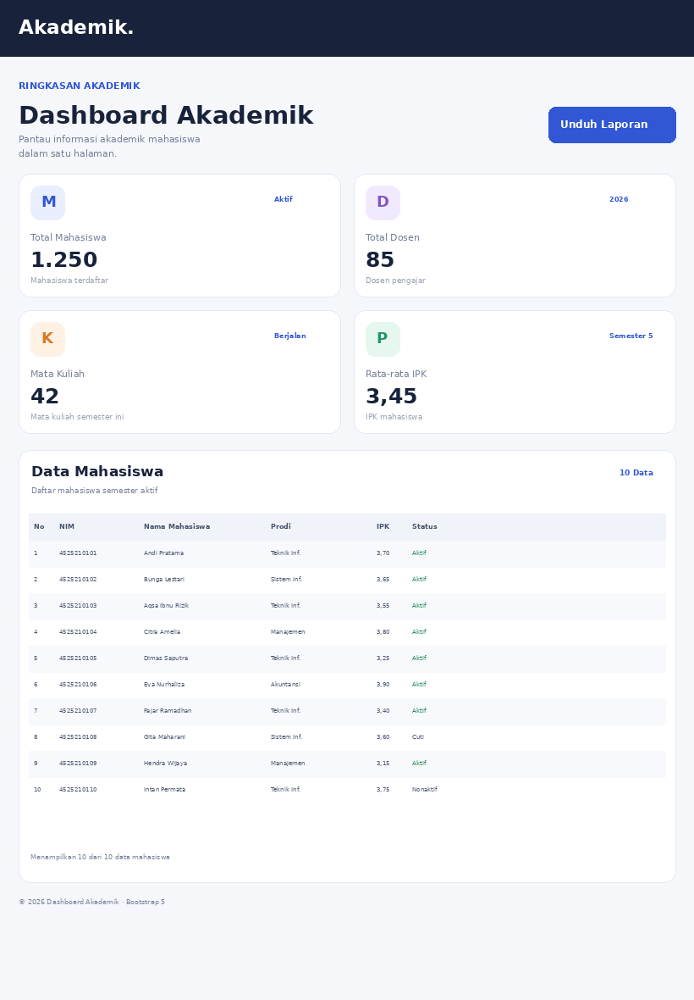
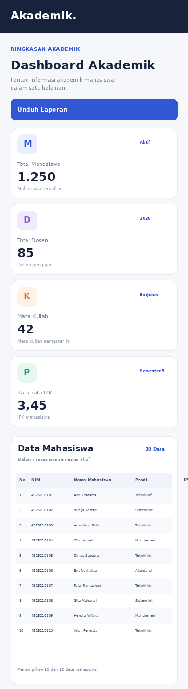

# Dashboard Akademik - Bootstrap 5

## Deskripsi
Project ini merupakan halaman dashboard akademik sederhana yang dibuat untuk memenuhi tugas individu. Halaman menampilkan empat kartu statistik dan tabel data mahasiswa yang berisi 10 baris.

## Teknologi
- HTML5
- CSS3
- Bootstrap 

## Fitur dan Komponen
1. **Empat statistic cards**: Total Mahasiswa, Total Dosen, Mata Kuliah, dan Rata-rata IPK.
2. **Tabel mahasiswa**: berisi 10 data dengan kolom nomor, NIM, nama, program studi, semester, IPK, dan status.
3. **Badge**: menunjukkan status data seperti Aktif, Cuti, dan Nonaktif.
4. **Button**: tombol Unduh Laporan dan Lihat Semua Data sebagai elemen pelengkap tampilan.
5. **Utility classes**: menggunakan beberapa utility Bootstrap seperti `py-4`, `mb-4`, `d-flex`, `justify-content-between`, `align-items-center`, `gap-3`, dan `text-secondary`.
6. **Table styling**: menggunakan `table-striped`, `table-hover`, `table-responsive`, dan `align-middle`.

## Penjelasan Perubahan Layout, Masalah, dan Solusi
- **HP**: kartu disusun satu kolom agar mudah dibaca. Tabel dapat digeser horizontal karena ruang layar terbatas.
- **Tablet**: kartu berubah menjadi dua kolom sehingga informasi lebih ringkas tanpa membuat kartu terlalu sempit.
- **Laptop/desktop lebar**: empat kartu ditampilkan sejajar dalam satu baris.
- **Masalah tabel pada layar kecil**: jika semua kolom dipaksakan tampil sekaligus, teks dapat menjadi terlalu rapat atau halaman melebar.
- **Solusi**: menggunakan `table-responsive` sehingga tabel tetap dapat diakses dengan scroll horizontal tanpa merusak lebar halaman.

## Hasil nya 

## Dekstop

## Tablet

## HP
